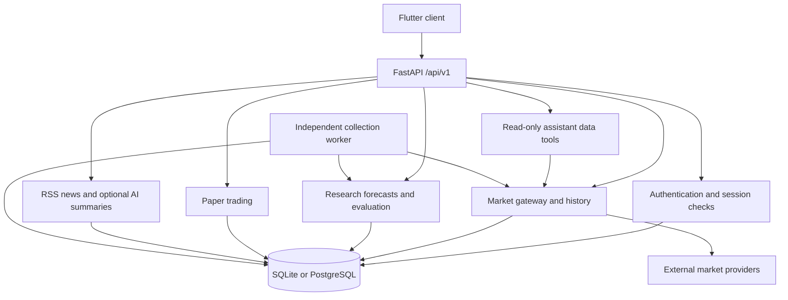

# Current architecture for continuation

This guide describes the integrated source preserved on 2026-11-01. It complements the dated [original architecture](ARCHITECTURE.md), which describes an earlier development stage. Use [current status](CURRENT_STATUS.md), [setup](SETUP.md) and [verification](VERIFICATION.md) when reconciling historical claims with this snapshot.

## Client and API boundary

The Flutter application presents charts, market information, news, settings and authentication. Its shared [backend connection](../frontend/lib/core/backend_connection.dart), [API client](../frontend/lib/core/backend_api_client.dart) and [session manager](../frontend/lib/core/backend_session.dart) connect screens to the backend. Refresh-token storage uses an OS-backed secure-storage abstraction. Provider credentials belong on the server, not in Flutter builds.

The FastAPI [application factory](../backend/app/main.py) initializes service clients and installs error handling, CORS and process-local rate limiting. The [API router](../backend/app/api/router.py) registers domain routes. Read the [API contract](API_CONTRACT.md) alongside route implementations: authenticated user access and owner/private operations have different authorization requirements. Authentication, market ingestion and paper accounts are not interchangeable trust boundaries.

## Persistence and market collection

[SQLAlchemy models](../backend/app/models/) and [Alembic migrations](../backend/migrations/) describe persistent state. Use a fresh database; private account and deployment data are excluded. SQLite supports local reproduction, while the supplied Docker configuration targets PostgreSQL development.

The [market service](../backend/app/services/market_data.py) normalizes provider responses and records provenance, currency, units, freshness and quality. [History services](../backend/app/services/history.py) distinguish upstream candles from observations aggregated locally. Missing data and incompatible evidence must remain visible rather than being fabricated.

Collection runs independently of opening the UI. The [worker](../backend/app/jobs/run_private_beta_worker.py) repeats the [private-beta cycle](../backend/app/jobs/run_private_beta_cycle.py): collect quotes, persist telemetry, derive eligible candles, attempt research forecasts and evaluate due records. It does not execute exchange orders. Provider availability and authorized usage require separate verification with the continuing developer's configuration.

## Implemented research versus planned product

The [forecast service](../backend/app/services/forecasting.py) contains the baseline/challenger research ensemble, chronological evaluation and evidence records. [Paper trading](../backend/app/services/paper_trading.py) supplies simulation APIs. These are implemented research components, not evidence of validated profitability or completion of the planned Phase 6 live/self-feedback predictor.

The [assistant tools](../backend/app/api/assistant_tools.py) expose bounded, read-only market queries; their latest-forecast tool explicitly reports Phase 6 unavailable. RSS ingestion, optional article translation/summaries and country-pulse evidence have separate services. Model access is external and optional. The exchange adapter remains a mock contract; real-money Wallex automation, budget allocation, complete billing and portions of the portfolio UI are unfinished.

## First continuation checkpoint

Follow [CONTINUING.md](CONTINUING.md) before changing functionality. Preserve API/schema/client alignment and immutable evidence. The fresh Ubuntu/Python 3.12 CI run recorded **212 passing tests and one XMR fallback failure**, despite 213 local Windows passes. A first-request cooldown condition is an unconfirmed candidate mechanism, not a proven diagnosis; see [KNOWN_ISSUES.md](KNOWN_ISSUES.md). That document also records the preserved shell-script line-ending limitation. No running application, production provider integration or universal cross-platform compatibility is certified by this architecture description.
