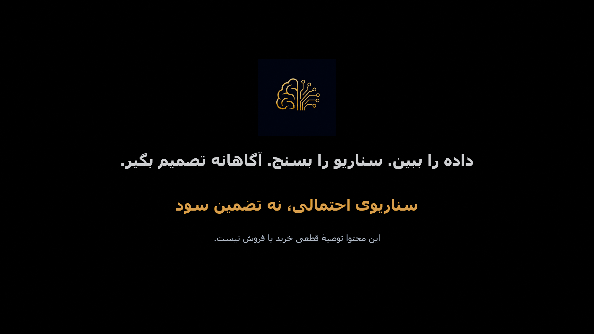

# GoldBrain 🧠✨

**Zeven maanden ambitie en leren, en een onvoltooide werkruimte voor financiële analyse.**

[English](https://github.com/FarlandGame/GoldBrain/blob/main/README.md) · [日本語](https://github.com/FarlandGame/GoldBrain/blob/main/docs/README.ja.md) · [فارسی](https://github.com/FarlandGame/GoldBrain/blob/main/docs/README.fa.md) · [Deutsch](https://github.com/FarlandGame/GoldBrain/blob/main/docs/README.de.md) · [Français](https://github.com/FarlandGame/GoldBrain/blob/main/docs/README.fr.md) · [Español](https://github.com/FarlandGame/GoldBrain/blob/main/docs/README.es.md) · [Português (Brasil)](https://github.com/FarlandGame/GoldBrain/blob/main/docs/README.pt-BR.md) · [Italiano](https://github.com/FarlandGame/GoldBrain/blob/main/docs/README.it.md) · [Nederlands](https://github.com/FarlandGame/GoldBrain/blob/main/docs/README.nl.md) · [Polski](https://github.com/FarlandGame/GoldBrain/blob/main/docs/README.pl.md) · [Українська](https://github.com/FarlandGame/GoldBrain/blob/main/docs/README.uk.md) · [Türkçe](https://github.com/FarlandGame/GoldBrain/blob/main/docs/README.tr.md) · [Русский](https://github.com/FarlandGame/GoldBrain/blob/main/docs/README.ru.md) · [简体中文](https://github.com/FarlandGame/GoldBrain/blob/main/docs/README.zh-CN.md) · [繁體中文](https://github.com/FarlandGame/GoldBrain/blob/main/docs/README.zh-TW.md) · [한국어](https://github.com/FarlandGame/GoldBrain/blob/main/docs/README.ko.md) · [हिन्दी](https://github.com/FarlandGame/GoldBrain/blob/main/docs/README.hi.md) · [Bahasa Indonesia](https://github.com/FarlandGame/GoldBrain/blob/main/docs/README.id.md)

GoldBrain is een stopgezet experimenteel project van de tweelingbroers Bardiya en Armiya Alizadeh (Kabir). Het combineert een Flutter-interface die in de eerste plaats voor het Perzisch is ontworpen met een Python/FastAPI-backend. De broncode is bewaard zodat een andere ontwikkelaar het werk kan begrijpen, de huidige staat kan reproduceren en kan beslissen hoe het verder kan.

Makers: **Bardiya Alizadeh (Kabir) · Farland_game** en **Armiya Alizadeh (Kabir) · ArmiyaFbix**, gelijkwaardig vermeld op het meest recente Over-scherm en in de ontwikkelnotities van het project.

Bardiya beschrijft ongeveer zeven maanden werk. Hij begon met weinig programmeerervaring en leerde door te experimenteren, online bronnen te gebruiken en hulp van AI te krijgen. Het oorspronkelijke doel was een Windows/Android-product met marktvoorspellingen voor korte en lange termijnen, gevolgd door automatisch handelen op Wallex met alleen een door de gebruiker gekozen deel van diens geld. Hij stopte met het nastreven van die volledige visie vanwege de benodigde infrastructuur, kosten, complexiteit en financiële risico's. Dit waren doelen, geen voltooide of gevalideerde mogelijkheden.

> Het brein had grote plannen. De infrastructuurrekening had zo haar eigen plannen. 🧠🧾😅

## Wat de bewaarde broncode bevat

- Een eigen Flutter-interface met 11 thema's, 8 bestaande interfacetalen, animaties, grafieken, instellingen, volglijsten, audiobediening en een Over-pagina.
- Een FastAPI-backend met genormaliseerde marktkoersen en koersgeschiedenis, herkomstinformatie over aanbieders, controles op actualiteit en kwaliteit, opgeslagen overzichtsgegevens en een verzamelproces.
- Een experimentele voorspellingsengine met berekende kenmerken, chronologische evaluatie/backtesting en bewijsregistraties; deze staat los van de onvoltooide uiteindelijke voorspeller.
- API's voor gesimuleerde handel; de zichtbare portefeuille-interface en handelen met echt geld zijn niet af.
- Processen voor e-mailverificatie en wachtwoordherstel, wachtwoorden met Argon2, JWT-toegangstokens, rotatie van vernieuwingstokens en beheer van apparaten en sessies.
- RSS-nieuws, optionele AI-vertalingen en -samenvattingen van artikelen, een begrensde chatassistent met alleen leestoegang en een marktoverzicht van zes landen.
- Testbroncode voor de backend en Flutter, tien databasemigraties, configuratievoorbeelden, architectuur- en API-documentatie en historische voortgangs- en beslisverslagen.

## Waar het werk stopte

- Het voor Fase 6 geplande live voorspellingssysteem met terugkoppeling uit eigen resultaten is onvoltooid. Het bijbehorende assistenthulpmiddel meldt expliciet dat het niet beschikbaar is in plaats van een voorspelling te verzinnen.
- Automatisch handelen met echt geld op Wallex en het voorgestelde proces voor toewijzing van gebruikersbudget zijn niet geïmplementeerd. De beursadapter is een gesimuleerde interface.
- Dataovereenkomsten voor productiegebruik, onafhankelijk gevalideerde financiële prestaties, beveiliging voor publieke uitrol en betrouwbare toegang tot aanbieders blijven open werk.
- Betalingsverwerking, een complete portefeuille-interface en enkele zichtbare instellingen zijn onvoltooid. Een model voor abonnementen en toegangsrechten is geen voltooid afrekensysteem.
- De huidige geïntegreerde broncode heeft basisstructuren voor Windows en web; de oudere Android-structuur is apart bewaard. Een werkende actuele Android- of webversie is niet geverifieerd.

## Werk verder aan het project

Begin met de voortzettingsgids, de installatie vanaf een nieuwe kloon, de matrix met de huidige status en het verificatierapport. Historische documenten zijn met hun datums bewaard; hun faselabels, aanbiedersprijzen en oude testaantallen gaan niet boven de huidige broncode. Zorg voor je eigen dienstenconfiguratie en een nieuwe database. Er worden geen privéaccountdatabase, API-inloggegevens of Android-ondertekeningsidentiteit meegeleverd.

[Continuation guide](https://github.com/FarlandGame/GoldBrain/blob/main/docs/CONTINUING.md) · [Fresh-clone setup](https://github.com/FarlandGame/GoldBrain/blob/main/docs/SETUP.md) · [Current status matrix](https://github.com/FarlandGame/GoldBrain/blob/main/docs/CURRENT_STATUS.md) · [Verification report](https://github.com/FarlandGame/GoldBrain/blob/main/docs/VERIFICATION.md)

## Huisstijl en historisch materiaal

De aangeleverde projectposter en logo's zijn opgenomen. Audio wordt als apart middelenpakket verspreid op basis van de verklaring van de maker dat herdistributie is toegestaan; deze valt niet automatisch onder de codelicentie. Oudere broncodesnapshots zijn historische naslagwerken, geen onderling verwisselbare onderdelen van de huidige app.

*Historische promotieposter: toont de oorspronkelijke projectvisie, geen geverifieerde huidige versie.*

[Preservation release · preserved-2026-11-01](https://github.com/FarlandGame/GoldBrain/releases/tag/preserved-2026-11-01)

## Technische overdracht

De uitgebreide technische handleidingen zijn in het Engels, naast de bewaarde oorspronkelijke Engelse en Perzische projectdocumenten. Deze portfolio-introducties gebruiken dezelfde 18 documentatietalen als de rest van het portfolio; de 8 bestaande interfacetalen van de app zijn een aparte eigenschap.

[Version map](https://github.com/FarlandGame/GoldBrain/blob/main/docs/VERSION_MAP.md) · [Assets and license notices](https://github.com/FarlandGame/GoldBrain/blob/main/docs/ASSETS_AND_LICENSES.md) · [MIT code license](https://github.com/FarlandGame/GoldBrain/blob/main/LICENSE)

Lees de publicatie- en licentieregistratie van de repository en de afzonderlijke kennisgevingen over materiaal van derden voordat je code of media hergebruikt.

[Bardiya Alizadeh (Kabir) · Farland_game](https://github.com/FarlandGame)
